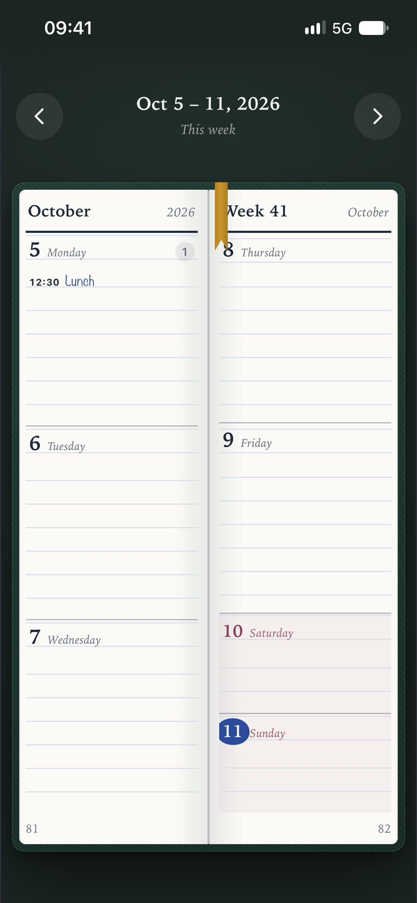
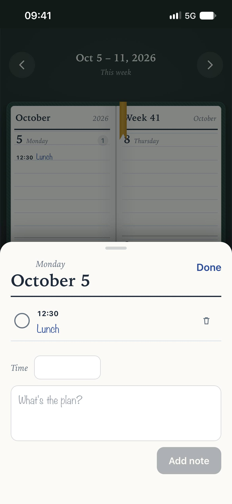
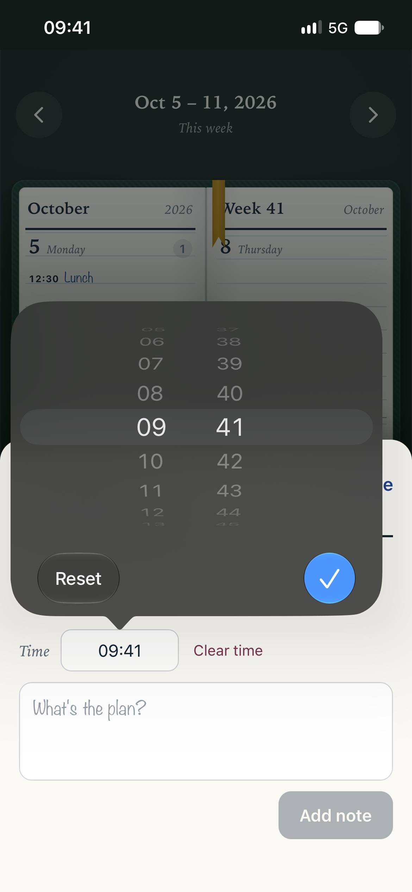

# Weekly Planner

A weekly planner for iPhone that looks and behaves like an open paper planner. Each week is a two-page spread, and moving between weeks turns the page like a real book.

Built with React and Capacitor. Runs as a native iOS app or as a home-screen web app (PWA).

<p align="center">
  
  &nbsp;&nbsp;
  
  &nbsp;&nbsp;
  
</p>


## Features

- **Book-style weekly spread.** Monday to Wednesday sit on the left page and Thursday to Sunday on the right. Saturday and Sunday are exactly half the height of a weekday, so the weekdays line up across the spine.
- **Page-turn navigation.** Swipe left or right, or use the arrow buttons, to flip to the next or previous week with a 3D page-turn animation.
- **Jump to any week.** Tap the date range in the top bar to open the date picker. A "Back to this week" button appears whenever you're viewing another week.
- **Notes for every day.** Tap a day to add, edit, tick off or delete notes. Each note can have an optional time, and notes are sorted by time.
- **Today at a glance.** The current date is circled in ink, and each day shows how many notes it holds.
- **Private and offline.** Everything is stored on the device. There are no accounts and no server.

## Getting started

You'll need Node.js 18 or later.

```bash
npm install
npm run dev
```

Then open the local URL Vite prints. The app is designed for a phone-sized screen, so use your browser's device emulation for the best preview.

## Running on an iPhone

### As a native app (Capacitor)

Requires a Mac with Xcode and a free Apple ID.

```bash
npm run build
npx cap sync ios
npx cap open ios
```

In Xcode, select the **App** target, open **Signing & Capabilities**, choose your Apple ID as the team, then select your iPhone and press Run. On iOS 16 or later, enable **Settings › Privacy & Security › Developer Mode** on the phone first.

> With a free Apple ID, the app has to be re-run from Xcode every 7 days. A paid Apple Developer account extends this to a year.

### As a home-screen web app (PWA)

1. Run `npm run build` and deploy the `dist` folder to any static host, such as Netlify, Vercel, Cloudflare Pages or GitHub Pages.
2. Open the site in Safari on your iPhone.
3. Tap **Share › Add to Home Screen**.

The app then opens full screen from its own icon, with no expiry.

## Data storage

Notes are saved in `localStorage` under the key `weekly-planner:v1`, grouped by date:

```json
{
  "2026-10-06": [
    { "id": "…", "time": "12:30", "text": "Lunch with Ana", "done": false, "createdAt": 1791000000000 }
  ]
}
```

Notes never leave the device, but deleting the app also deletes them. iOS may also clear app storage when the phone is critically low on space.

## Project structure

```
src/
  App.jsx    Planner logic: date helpers, pages, page flip, day sheet, CRUD
  App.css    Book styling, 3D page-turn animation, iOS safe areas
docs/        README screenshots
```

## Tech

- React 18
- Vite
- Capacitor (iOS)
- Plain CSS with 3D transforms; no UI libraries

## License

MIT
